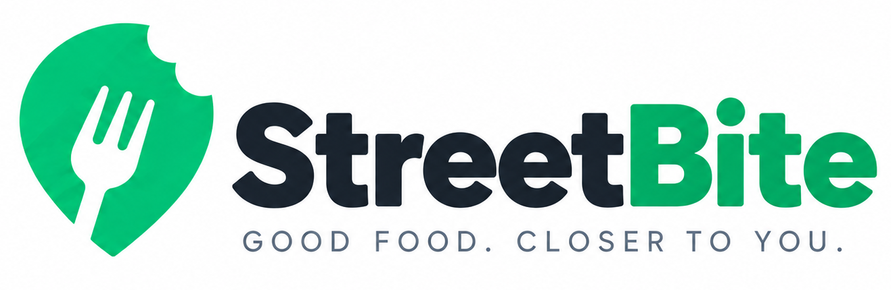
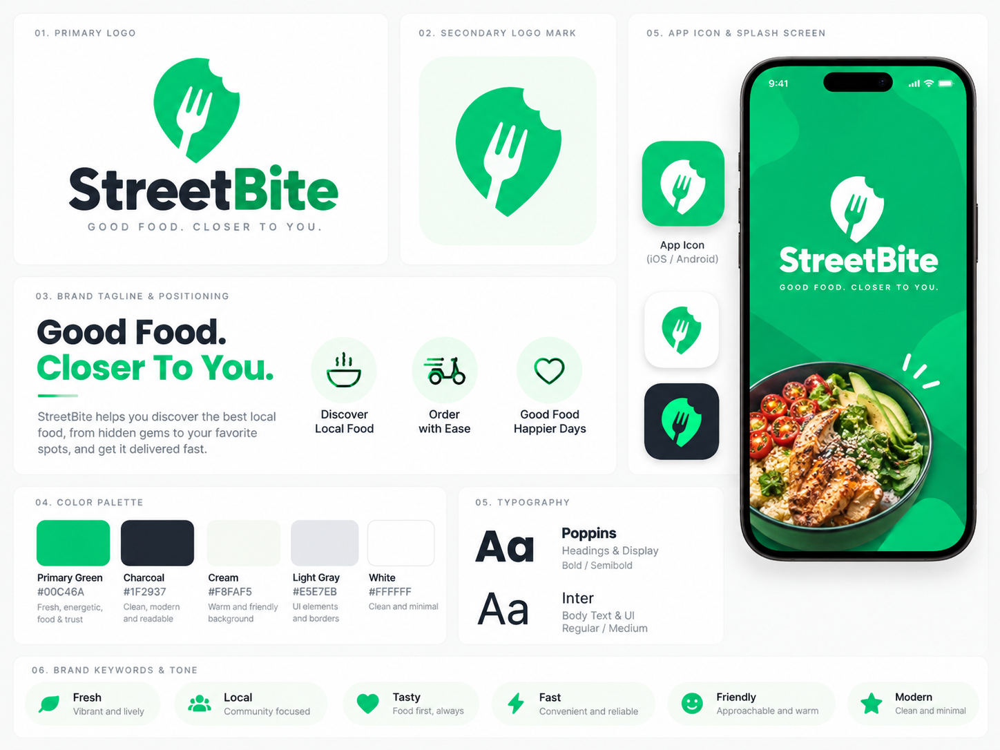
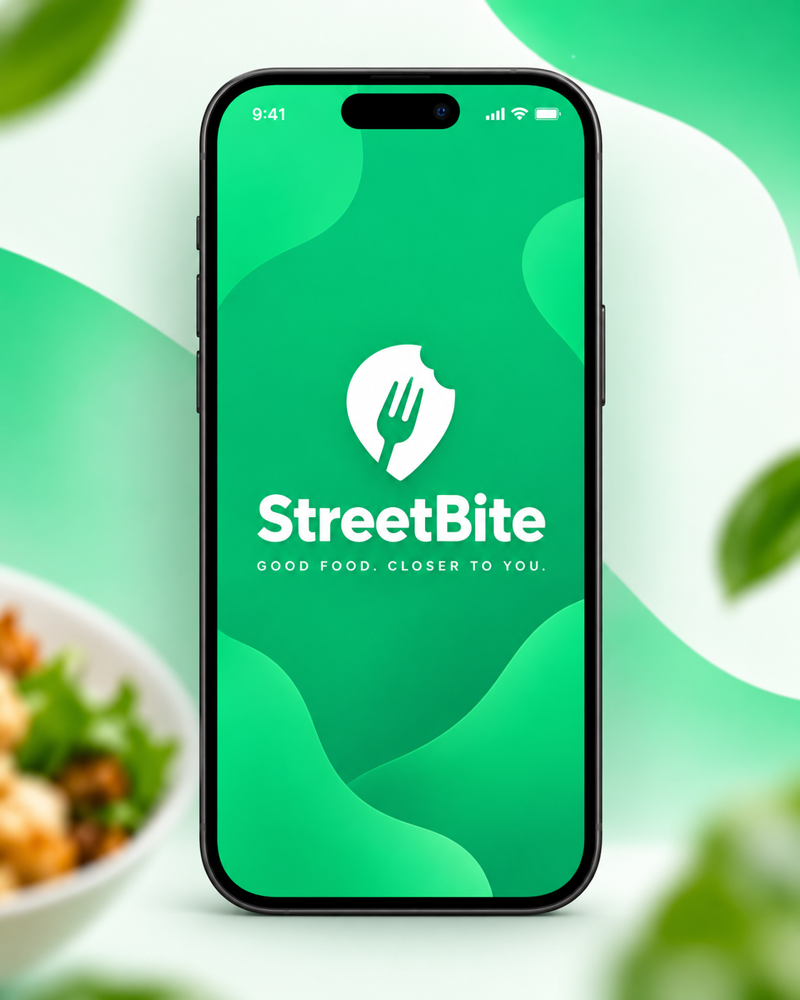

<p align="center">
  
</p>

<p align="center">
  <strong>Good Food. Closer to You.</strong>
</p>

## About

**StreetBite V1.0** is a Flutter food discovery and demo ordering app. Users can discover meals from **TheMealDB**, view meal details, save favourites, manage a cart, place demo orders, and review their order history.

The project was built as a production-oriented Flutter graduation project using **Clean Architecture, Firebase, BLoC/Cubit, dependency injection, localization, testing, and Android release preparation**.

## Features

- Email/password **Sign Up, Login and authentication state handling** with Firebase Auth
- Firestore-backed **user profiles, favourites and orders**
- Live meal data from **TheMealDB** using Dio
- Local menu caching using `shared_preferences`
- Featured meals and **Hot Offers**
- Meal details and food discovery
- Save and remove **favourite meals**
- Reactive **shopping cart** using BLoC/Cubit
- Demo checkout with **Cash on Delivery** and simulated card payment (**no real charges**)
- Order creation and **order history**
- User profile and settings
- **English / Arabic localization** with RTL support
- **Light / Dark themes**
- Device information
- **Nearby Vendors with Google Maps**
- Fingerprint / biometric profile access using `local_auth`
- Dependency injection with **GetIt**
- Android app icon, splash/branding assets and release build support

> Google Maps and biometric authentication are optional Android features and require supported hardware/device configuration and API setup.

## Technology

Flutter · Dart · Firebase Auth · Cloud Firestore · Dio · `flutter_bloc` · GetIt · `shared_preferences` · `google_maps_flutter` · `local_auth` · `device_info_plus` · `image_picker`

**Architecture:** Clean Architecture with separated Data, Domain and Presentation layers.

```text
lib/data/ → lib/domain/ ← lib/presentation/
```

The project also demonstrates **Builder, Factory, Singleton and Strategy** design patterns.

## Project Structure

```text
streetbite/
├── README.md
├── screenshots/                 # App screenshots and branding evidence
│   ├── streetbite_logo.png
│   ├── streetbite_icon.png
│   ├── img1.png                 # Brand guide
│   ├── img2.png                 # Splash screen concept
│   └── Screenshot...            # Android execution screenshots
│
└── flutter_app/
    ├── android/                  # Android platform configuration
    ├── ios/                      # iOS platform configuration
    ├── assets/
    │   └── branding/             # App branding assets
    │
    ├── lib/
    │   ├── core/
    │   │   ├── constants/
    │   │   ├── errors/
    │   │   ├── network/
    │   │   ├── services/
    │   │   ├── theme/
    │   │
    │   ├── data/
    │   │   ├── datasources/
    │   │   ├── models/
    │   │   └── repositories/
    │   │
    │   ├── domain/
    │   │   ├── entities/
    │   │   ├── repositories/
    │   │   ├── services/
    │   │   └── usecases/
    │   │
    │   ├── presentation/
    │   │   ├── blocs/
    │   │   ├── screens/
    │   │   │   ├── cart/
    │   │   │   ├── favourites/
    │   │   │   ├── home/
    │   │   │   ├── meal_details/
    │   │   │   ├── orders/
    │   │   │   ├── profile/
    │   │   │   ├── settings/
    │   │   │   ├── splash/
    │   │   │   └── vendors/
    │   │   └── widgets/
    │   │
    │   ├── l10n/                 # English / Arabic localization
    │   ├── firebase_options.dart
    │   ├── injection.dart        # Dependency injection
    │   └── main.dart
    │
    ├── test/
    │   ├── data/
    │   ├── domain/
    │   └── presentation/
    │
    ├── l10n.yaml
    └── pubspec.yaml
```

## Screenshots

The repository includes a dedicated [`screenshots/`](screenshots/) folder containing **real Android execution screenshots and project branding assets**.

These screenshots provide evidence of implemented application screens and features for final QA and project submission.

Branding files include:

- `streetbite_logo.png` — StreetBite logo
- `streetbite_icon.png` — application icon
- `img1.png` — brand guide
- `img2.png` — splash screen concept
- Android screenshots — actual application execution and feature evidence

## Run Locally

```bash
cd flutter_app
flutter pub get
flutterfire configure
flutter gen-l10n
flutter run
```

Requires Flutter, an Android device/emulator, and a Firebase project with **Email/Password Authentication** and **Cloud Firestore** configured.

`flutterfire configure` generates the platform Firebase configuration. Do not commit private credentials or service-account keys.

### Google Maps Key (Android)

1. Enable **Maps SDK for Android** and billing in Google Cloud.
2. Copy `android/secrets.properties.example` to `android/secrets.properties` and replace the placeholder with your key.
3. Configure the Android manifest/Gradle Secrets plugin to read `MAPS_API_KEY`.
4. Restrict the API key using the Android package name and signing SHA-1, including the release SHA-1.
5. **Never commit `android/secrets.properties`.**

For Web maps, use a separate browser-restricted key and Web configuration.

```properties
MAPS_API_KEY=YOUR_GOOGLE_MAPS_API_KEY
```

## Quality & Release

```bash
dart format .
flutter analyze
flutter test
flutter build apk --release
```

Release APK:

```text
flutter_app/build/app/outputs/flutter-apk/app-release.apk
```

The release can be distributed through **Firebase App Distribution** to at least two testers.

Final QA results and screenshots should represent **actual application executions rather than concept mockups**.

## Branding

StreetBite uses a simple food-focused visual identity designed around the application UI and its orange/red brand palette.

### Brand Guide



| App Icon | Splash Screen Concept |
|---|---|
|  |  |

---

**StreetBite V1.0 — Good Food. Closer to You.**
